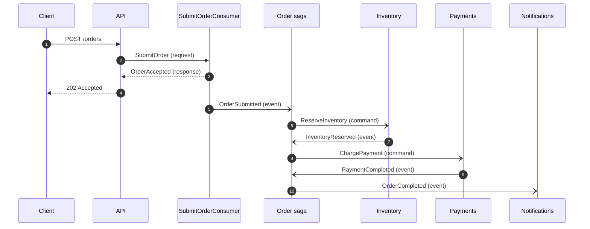
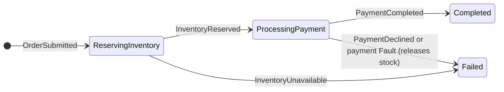

# MassTransit by example: an order saga

A small, runnable order system for learning [MassTransit](https://masstransit.io). An HTTP API
takes an order. A **saga** coordinates reserving stock and charging a card. **Retries** absorb a
flaky payment gateway. **Compensation** undoes work when a later step fails. The **transactional
outbox** keeps the database and the message broker consistent.

It runs against real RabbitMQ and PostgreSQL (in Docker), and every step is logged, so you can
watch messages move through the system.

.NET 10 · MassTransit 8.5 · RabbitMQ 4 · PostgreSQL 17 · EF Core 10

> MassTransit v9 and later are commercially licensed. This demo uses v8, which is Apache 2.0.
> The concepts are the same in v9.

## Run it

You need the [.NET 10 SDK](https://dotnet.microsoft.com/download) and Docker.

```bash
docker compose up -d --wait                 # RabbitMQ + PostgreSQL
dotnet run --project src/OrderSystem.Api    # http://localhost:5200
```

Place an order, then ask for its status:

```bash
curl -i -X POST http://localhost:5200/orders -H "Content-Type: application/json" \
  -d '{"customerId":"alice","paymentMethod":"card-ok","lines":[{"sku":"MUG","quantity":2}]}'

curl http://localhost:5200/orders/<orderId from the response>
```

[`OrderSystem.Api.http`](src/OrderSystem.Api/OrderSystem.Api.http) has every scenario below, ready
to send from Visual Studio, Rider, or VS Code (REST Client extension). On Windows, the `.http` file
is also the easiest way to avoid shell-quoting issues with `curl`.

| | |
|---|---|
| RabbitMQ management UI | http://localhost:15672 (guest / guest) |
| Database shell | `docker compose exec postgres psql -U postgres -d order_system` |
| Tests (no Docker needed) | `dotnet test` |
| Reset queues and database | `docker compose down`, then `docker compose up -d --wait` |

## What happens when you place an order



1. The API **sends a request** (`SubmitOrder`) and waits for a **response**. `SubmitOrderConsumer`
   validates and prices the order, replies `OrderAccepted` (or `OrderRejected`), and **publishes**
   `OrderSubmitted`.
2. `OrderSubmitted` starts the **saga**, a state machine with one database row per order. It
   **sends** `ReserveInventory` and waits.
3. The inventory consumer reserves stock and publishes `InventoryReserved` (or `InventoryUnavailable`).
4. The saga sends `ChargePayment`. The payment consumer calls a fake payment gateway and publishes
   `PaymentCompleted` (or `PaymentDeclined`).
5. The saga publishes `OrderCompleted` (or `OrderFailed`), and a notification consumer "emails" the customer.

The HTTP call returns after step 1 with `202 Accepted`. Everything after that happens in the
background. `GET /orders/{id}` shows progress, and the saga itself answers that request.



## Try these scenarios

The payment method decides what the fake payment gateway does:

| `paymentMethod` | What the gateway does | What it teaches |
|---|---|---|
| `card-ok` | Approves | The happy path |
| `card-flaky` | Fails twice, then approves | Retry |
| `card-declined` | Declines the card | A business failure and compensation |
| `gateway-down` | Always fails | Retries run out, error queue, `Fault<T>`, compensation |

The catalog starts with 100 `MUG`, 3 `PLUSH`, and 0 `BOOK` (`GET /inventory`).

### 1. The happy path (`card-ok`)

Watch the console. Each service logs its step, and the saga logs every state it enters (abridged):

```text
SubmitOrderConsumer      Order 1f9a... accepted for alice, total 25.00
OrderStateMachine        Order 1f9a... is now Initial
OrderStateMachine        Order 1f9a... is now ReservingInventory
ReserveInventoryConsumer Order 1f9a...: reserved 2 x MUG
OrderStateMachine        Order 1f9a... is now ProcessingPayment
ChargePaymentConsumer    Order 1f9a...: charging 25.00 to card-ok (attempt 1)
ChargePaymentConsumer    Order 1f9a...: payment approved (txn_6df09f63a7bd)
OrderStateMachine        Order 1f9a... is now Completed
CustomerNotification...  EMAIL to alice: your order 1f9a... is confirmed, total 25.00
```

### 2. Retry (`card-flaky`)

Attempt 1 fails. MassTransit logs `R-RETRY`, waits, and runs the consumer again. Attempt 3 succeeds
and the order completes as if nothing happened. The policy is in `ChargePaymentConsumerDefinition`:

```csharp
endpointConfigurator.UseMessageRetry(r =>
{
    r.Handle<PaymentGatewayUnavailableException>();  // retry only failures that might go away
    r.Exponential(retryLimit: 4, minInterval: TimeSpan.FromMilliseconds(200),
        maxInterval: TimeSpan.FromSeconds(5), intervalDelta: TimeSpan.FromMilliseconds(300));
});
```

### 3. Compensation (`card-declined`)

A declined card is a normal business outcome, so the consumer **publishes `PaymentDeclined`
instead of throwing**. Throwing would only trigger retries that can't change the answer. Stock is
already reserved, so the saga **compensates** by sending `ReleaseInventory`. Check `GET /inventory`:
the stock is back.

### 4. Faults and the error queue (`gateway-down`)

After 5 attempts (1 plus 4 retries, about 6 seconds), MassTransit gives up:

- The message moves to the **`charge-payment_error`** queue. In the RabbitMQ UI, open that queue
  and click *Get messages*. The original message is intact, with `MT-Fault-*` headers holding the
  exception, stack trace, and retry count. After fixing the problem, you can move the messages
  back to the original queue to reprocess them.
- MassTransit publishes **`Fault<ChargePayment>`**. The saga subscribes to it and compensates just
  as it does for a declined card.

### 5. Out of stock

Order a `BOOK`. The inventory consumer publishes `InventoryUnavailable` and the order fails.
Nothing was reserved, so there is nothing to compensate. Reservation is all-or-nothing: a `MUG` on
the same order isn't reserved either.

### 6. The outbox: stop RabbitMQ

`POST /inventory/{sku}/restock` updates the stock and publishes `InventoryRestocked` **in a single
database transaction**, using the bus outbox. Stop the broker and try it:

```bash
docker compose stop rabbitmq

curl -X POST http://localhost:5200/inventory/BOOK/restock \
  -H "Content-Type: application/json" -d '{"quantity":5}'
# 200 OK: the stock change is saved, and the event is waiting in the outbox table
docker compose exec postgres psql -U postgres -d order_system \
  -c 'SELECT "MessageType", "SentTime" FROM "OutboxMessage";'

docker compose start rabbitmq
# once MassTransit reconnects (~20s): "EMAIL to subscribers: BOOK was restocked, 5 now available"
```

Now try `POST /orders` while RabbitMQ is stopped. The request **hangs until the broker is back**:
request/response needs the broker up, and the outbox doesn't.

### 7. Concurrency: a race for the last units

Send several orders for `PLUSH` at once (bash, Git Bash, or WSL):

```bash
for i in $(seq 1 8); do
  curl -s -X POST http://localhost:5200/orders -H "Content-Type: application/json" \
    -d '{"customerId":"racer'$i'","paymentMethod":"card-ok","lines":[{"sku":"PLUSH","quantity":1}]}' &
done; wait
```

Only as many orders complete as there were units, and the rest fail as out of stock. In the log
you'll see `fail:` lines from EF Core ("could not serialize access due to concurrent update"),
followed by `R-RETRY`. Two consumers updated the same product at the same moment, and Postgres
rejected one. MassTransit retried it, and the retry saw the new stock level. The errors are
expected: that is the concurrency control working.

### 8. Look inside the bus

`GET /debug/bus` returns MassTransit's probe of everything it built: each queue, its exchange
bindings, and each endpoint's middleware pipeline. Search for `charge-payment` to see the order
the filters run in: `deadLetter` → `rescue` → `deserialize` → `retry` → `outbox` → `ChargePaymentConsumer`.

## Where each concept lives

| Concept | Look at |
|---|---|
| Commands vs. events | [`Contracts/Commands.cs`](src/OrderSystem.Contracts/Commands.cs), [`Contracts/Events.cs`](src/OrderSystem.Contracts/Events.cs) |
| Request/response | [`Orders/OrderEndpoints.cs`](src/OrderSystem.Api/Orders/OrderEndpoints.cs), [`Orders/SubmitOrderConsumer.cs`](src/OrderSystem.Api/Orders/SubmitOrderConsumer.cs) |
| A consumer and its definition | [`Inventory/ReserveInventoryConsumer.cs`](src/OrderSystem.Api/Inventory/ReserveInventoryConsumer.cs) |
| The saga | [`Orders/OrderStateMachine.cs`](src/OrderSystem.Api/Orders/OrderStateMachine.cs), [`Orders/OrderState.cs`](src/OrderSystem.Api/Orders/OrderState.cs) |
| Compensation | `PaymentDeclined` and `PaymentFaulted` in the saga, [`ReleaseInventoryConsumer.cs`](src/OrderSystem.Api/Inventory/ReleaseInventoryConsumer.cs) |
| Retry and exception filters | [`Payments/ChargePaymentConsumer.cs`](src/OrderSystem.Api/Payments/ChargePaymentConsumer.cs) (the definition) |
| Faults | `Event<Fault<ChargePayment>>` in the saga |
| Consumer outbox and inbox | `UseEntityFrameworkOutbox` in every definition, [`Data/OrderSystemDbContext.cs`](src/OrderSystem.Api/Data/OrderSystemDbContext.cs) |
| Bus outbox | `UseBusOutbox()` in [`Program.cs`](src/OrderSystem.Api/Program.cs), [`Inventory/InventoryEndpoints.cs`](src/OrderSystem.Api/Inventory/InventoryEndpoints.cs) |
| Publish/subscribe | [`Notifications/CustomerNotificationConsumer.cs`](src/OrderSystem.Api/Notifications/CustomerNotificationConsumer.cs) |
| Idempotency | [`Payments/PaymentGateway.cs`](src/OrderSystem.Api/Payments/PaymentGateway.cs) (idempotency key), the inbox, `ReleaseInventoryConsumer` |
| Testing | [`tests/OrderSystem.Tests`](tests/OrderSystem.Tests) |

## Key ideas

### Send vs. publish

- **Commands** (`ReserveInventory`, `ChargePayment`) ask one specific service to do something. They
  are **sent** to that service's queue by address (`queue:reserve-inventory`, see `QueueNames`).
- **Events** (`OrderSubmitted`, `PaymentCompleted`) announce something that already happened. They
  are **published**. RabbitMQ gets an exchange per message type (see *Exchanges* in the UI), and
  every queue subscribed to that type gets a copy. The publisher doesn't know who is listening:
  adding `CustomerNotificationConsumer` didn't change the saga at all.

`cfg.ConfigureEndpoints(context)` in `Program.cs` builds that topology from the registered consumers:
a queue per consumer or saga, bound to the message types it handles.

### Request/response

`GetResponse<OrderAccepted, OrderRejected>(...)` sends a request and awaits one of two response
types. Replies come back to a temporary queue for this app instance (the `..._bus_...` queue in
the UI). Use it when the caller really needs an answer right now. Otherwise prefer sending a
command and reacting to events, which keeps working when the other side is slow or down.

### Sagas

`OrderStateMachine` is a `MassTransitStateMachine<OrderState>`:

- **Events** find their saga instance by correlation, here the order id (`CorrelateById`).
- **States** decide which events are expected. `Initially(...)`, `During(...)`, and `DuringAny(...)`
  define what happens for each event in each state: change data, send, publish, respond, transition.
- **Persistence**: each order is a row in the `Orders` table. While a message is processed, the
  row is locked (`SELECT ... FOR UPDATE`), so two events for the same order never race.

The saga never calls a service and waits for it. It sends a command, saves its state, and goes
idle until the next event arrives. That's why a crash or restart mid-order loses nothing.

### Retry

A consumer signals "that didn't work" by throwing. `UseMessageRetry` catches the exception and runs
the consumer again: `Immediate`, `Intervals`, or `Exponential`, with `Handle<T>()` and `Ignore<T>()`
to choose which exceptions deserve another try. When retries run out, the message moves to
`<queue>_error` and MassTransit publishes `Fault<T>`.

Business outcomes such as a declined card or missing stock are **events, not exceptions**.
Retrying can't change the answer.

A second level of retry, **redelivery** (`UseDelayedRedelivery`), puts the message back on the
broker to try again minutes later, and frees the consumer while it waits. It needs a message
scheduler (for RabbitMQ, the delayed-message-exchange plugin), so this demo doesn't use it.

### The transactional outbox

The problem is a *dual write*: a handler that saves to the database **and** publishes a message is
updating two systems. A crash between the two leaves them disagreeing: stock reserved but nobody
told, or an event announcing a change that was rolled back.

The outbox writes outgoing messages to the same database, **in the same transaction** as the
business data, and delivers them after commit.

- **Consumer outbox** (`UseEntityFrameworkOutbox` in every definition). Each message is handled in
  a transaction. Anything the consumer publishes, sends, or responds with lands in the
  `OutboxMessage` table and reaches RabbitMQ only after commit. It doubles as an **inbox**:
  `InboxState` records processed message ids (for 30 minutes by default), so a redelivered message
  isn't handled twice.
- **Bus outbox** (`UseBusOutbox()` in `Program.cs`). The same idea for code that isn't a consumer.
  In `InventoryEndpoints.Restock`, `Publish` only adds a row, `SaveChangesAsync` commits it together
  with the stock change, and a background service delivers it.

**Order matters:** retry must wrap the outbox, so each attempt starts a fresh transaction. Every
definition calls `UseMessageRetry` first, then `UseEntityFrameworkOutbox`.

### Idempotency

Messages are delivered **at least once**, so every handler must tolerate seeing a message twice:

- The inbox drops a second delivery of the same message.
- The inbox can't protect calls to external systems. `IPaymentGateway.Charge` takes an idempotency
  key (the order id), so a retry never charges the card twice.
- `ReleaseInventoryConsumer` is idempotent by design: a second run finds nothing left to release.

### Testing

The tests use MassTransit's in-memory test harness, with no RabbitMQ or Postgres:

- `OrderStateMachineTests` drives the saga by publishing events, then asserts on its state and
  on what it sent and published.
- `PaymentRetryTests` runs the saga with the real payment consumer: retry, fault, and compensation end to end.
- `SubmitOrderConsumerTests` tests request/response against a consumer that uses EF Core (SQLite in-memory).

## Things that surprise people

- **The request timeout starts only after the request is sent.** If RabbitMQ is down, `GetResponse`
  waits for the broker instead of failing after 10 seconds. If you need a hard limit, pass a
  cancellation token with a deadline.
- **Every saga instance starts in `Initial`**, which is why the log shows "is now Initial" just
  before the first real state.
- **`fail:` lines from EF Core under load aren't bugs.** The outbox runs each message in a
  REPEATABLE READ transaction, so Postgres rejects conflicting updates ("could not serialize
  access"), and MassTransit retries.
- **Queue names come from class names** (`CustomerNotificationConsumer` → `customer-notification`).
  Queues that others send to get explicit names from `QueueNames`, so renaming a class can't break routing.
- **Message types are identified by namespace and name** (`urn:message:OrderSystem.Contracts:OrderSubmitted`).
  Moving a contract to a different namespace is a breaking change.

## Project layout

```text
src/OrderSystem.Contracts/   messages: commands, events, requests/responses, queue names
src/OrderSystem.Api/
  Program.cs                 MassTransit, RabbitMQ, and EF Core outbox wiring
  Orders/                    API endpoints, SubmitOrderConsumer, the order saga
  Inventory/                 stock consumers, the restock endpoint (bus outbox)
  Payments/                  ChargePaymentConsumer and the fake payment gateway
  Notifications/             a publish/subscribe consumer
  Data/                      DbContext (saga + outbox tables) and seed data
tests/OrderSystem.Tests/     test harness tests
```

To stay small, one process hosts every "service", and they share one database. In production,
Orders, Inventory, and Payments would be separate deployments, each with its own database and its
own outbox tables. They only talk through messages, so splitting them changes the hosting, not the code.

## Exercises

1. Add a shipping step: after payment, send `ShipOrder`, wait for `OrderShipped`, then complete the order.
2. Give customers loyalty points for completed orders with a new consumer of `OrderCompleted`, without touching the saga.
3. Make `card-flaky` fail 5 times instead of 2. What happens to the order, and where can you see why?
4. Fail orders whose payment takes longer than 30 seconds, using a saga `Schedule`. This needs a message scheduler.
5. Move Payments into its own process. Which files change?
